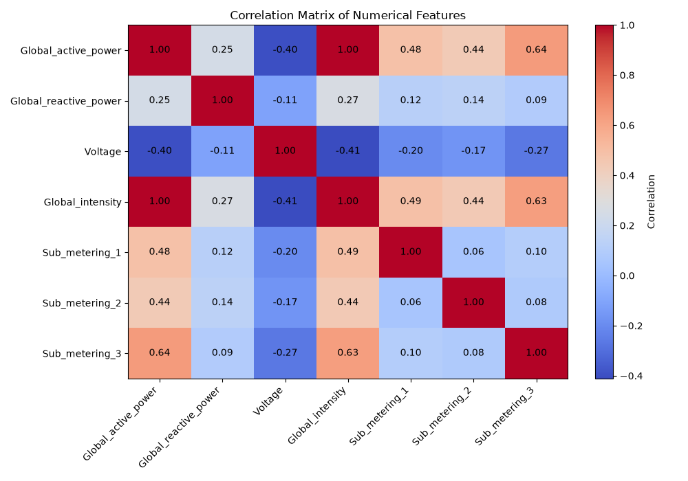

# ⚡ Household Energy Forecasting

<p align="center">
  <strong>Exploratory Data Analysis · Time-Series Forecasting · Deep Learning</strong>
</p>

<p align="center">
  
  
  
  
  
</p>

<p align="center">
  
  
</p>

---

## 📌 Overview

This project explores household electricity consumption data and develops a deep learning pipeline for forecasting future energy usage.

The workflow covers data inspection, exploratory data analysis, missing-value handling, temporal feature engineering, chronological splitting, feature scaling, and initial neural network development.

> **Project status:** The initial neural network architecture has been defined and compiled. Training and forecasting evaluation are upcoming steps.

## 🎯 Objectives

- 🔎 Perform exploratory data analysis (EDA).
- 🧹 Identify and handle missing values.
- 📊 Investigate feature distributions, skewness, outliers, and correlations.
- 🕒 Analyze temporal patterns and consumption trends.
- ⚙️ Engineer temporal features and prepare forecasting inputs.
- 📏 Apply appropriate feature scaling without data leakage.
- 🧠 Develop deep learning models using TensorFlow/Keras.
- 📈 Evaluate and compare forecasting performance.

## 📂 Dataset

**Individual Household Electric Power Consumption**

Source: [UCI Machine Learning Repository](https://archive.ics.uci.edu/dataset/235/individual+household+electric+power+consumption)

The dataset contains approximately four years of household electricity measurements recorded at one-minute intervals.

| Feature | Description |
|---|---|
| `Date` | Measurement date |
| `Time` | Measurement time |
| `Global_active_power` | Total active power consumption |
| `Global_reactive_power` | Total reactive power |
| `Voltage` | Average voltage |
| `Global_intensity` | Average current intensity |
| `Sub_metering_1` | Energy sub-metering for kitchen appliances |
| `Sub_metering_2` | Energy sub-metering for laundry appliances |
| `Sub_metering_3` | Energy sub-metering for other appliances |

The final forecasting target and prediction horizon will be determined during model development.

## 🛠️ Tech Stack

| Tool | Purpose |
|---|---|
| Python | Core programming language |
| Jupyter Notebook | Interactive development |
| Pandas & NumPy | Data manipulation and numerical computation |
| Matplotlib & Seaborn | Visualization and statistical analysis |
| Scikit-learn | Preprocessing and data splitting |
| TensorFlow / Keras | Neural network development |

---

## 🔬 Project Workflow

### 01 · Data Loading & Inspection

- Loaded the dataset into a Pandas DataFrame.
- Examined dataset dimensions, column names, and data types.
- Calculated descriptive statistics.
- Inspected missing values, unique values, and value frequencies.

### 02 · Exploratory Data Analysis

Performed distribution analysis, skewness analysis, potential outlier detection using the Interquartile Range (IQR) method, and correlation analysis.

#### Potential Outliers

| Feature | Number of Potential Outliers |
|---|---:|
| `Global_active_power` | 94,907 |
| `Voltage` | 51,067 |

These observations were flagged by the IQR method and were not automatically removed.

#### Feature Skewness

| Feature | Skewness |
|---|---:|
| `Global_active_power` | ~1.79 |
| `Global_reactive_power` | ~1.26 |
| `Voltage` | ~-0.33 |
| `Global_intensity` | ~1.85 |
| `Sub_metering_1` | ~5.94 |
| `Sub_metering_2` | ~7.09 |
| `Sub_metering_3` | ~0.72 |

#### Correlation with Global Active Power

| Feature | Correlation |
|---|---:|
| `Global_intensity` | ~1.00 |
| `Sub_metering_3` | ~0.64 |
| `Sub_metering_1` | ~0.48 |
| `Sub_metering_2` | ~0.44 |
| `Global_reactive_power` | ~0.25 |
| `Voltage` | ~-0.40 |

The correlation matrix was saved to:

`images/correlation_matrix.png`

<p align="center">
  
</p>

### 03 · Missing Value Handling

Missing values in numerical features were handled using statistical imputation.

**Median imputation** was applied to skewed consumption-related features:

- `Global_active_power`
- `Global_reactive_power`
- `Global_intensity`
- `Sub_metering_1`
- `Sub_metering_2`
- `Sub_metering_3`

**Mean imputation** was applied to `Voltage`, whose observed distribution had relatively low skewness.

After imputation, all numerical features contained **0% missing values**.

### 04 · Temporal Feature Engineering

The `Date` and `Time` columns were combined into a single `datetime` column using:

```python
df["datetime"] = pd.to_datetime(
    df["Date"] + " " + df["Time"],
    format="%d/%m/%Y %H:%M:%S"
)
```

The following temporal features were extracted:

- `Year`
- `Month`
- `Day`
- `DayOfWeek`
- `Hour`
- `Minute`

`DayOfWeek` uses values from `0` (Monday) to `6` (Sunday).

The original `datetime` column was retained for temporal analysis and future sequence generation.

### 05 · Chronological Data Splitting

The dataset was split chronologically using Scikit-learn's `train_test_split` with `shuffle=False`.

| Dataset | Proportion | Observations |
|---|---:|---:|
| Training | 72% | 1,494,186 |
| Validation | 8% | 166,021 |
| Test | 20% | 415,052 |
| **Total** | **100%** | **2,075,259** |

**Temporal order:** Past → Training → Validation → Test → Future

Preserving temporal order helps prevent future observations from entering the training set. Additional care will be needed when generating sequences and selecting forecasting targets.

### 06 · Feature Scaling

Numerical electricity measurements were standardized using Scikit-learn's `StandardScaler`.

To prevent data leakage, the scaler was fitted only on the training set.

| Dataset | Operation |
|---|---|
| Training | `fit_transform()` |
| Validation | `transform()` |
| Test | `transform()` |

The standardized features include:

- `Global_active_power`
- `Global_reactive_power`
- `Voltage`
- `Global_intensity`
- `Sub_metering_1`
- `Sub_metering_2`
- `Sub_metering_3`

Temporal features will be handled separately. Cyclical encoding may be applied to periodic features such as `Hour`, `DayOfWeek`, and `Month`.

### 07 · Initial Neural Network

An initial fully connected neural network was defined using the **Keras Functional API**.

#### Architecture

```text
Input (6 features)
       │
       ▼
Dense (20 neurons, ReLU)
       │
       ▼
Dropout (10%)
       │
       ▼
Dense (15 neurons, ReLU)
       │
       ▼
Dropout (15%)
       │
       ▼
Dense (1 neuron, Linear)
```

#### Layer Configuration

| Layer | Configuration | Purpose |
|---|---|---|
| Input | 6 features | Accept numerical inputs |
| Dense | 20 neurons, ReLU | Learn nonlinear patterns |
| Dropout | 0.10 | Regularization |
| Dense | 15 neurons, ReLU | Learn additional representations |
| Dropout | 0.15 | Regularization |
| Output | 1 neuron | Produce a continuous prediction |

#### Compilation Configuration

| Parameter | Value |
|---|---|
| Optimizer | Adam |
| Learning rate | `0.0001` |
| Loss function | Mean Squared Error (MSE) |
| Metric | Mean Absolute Error (MAE) |

MSE is used as the optimization objective, while MAE measures the average absolute difference between predicted and actual values.

The current architecture is an initial baseline, not a validated forecasting model. The input dimensions and output target must be aligned with the final forecasting setup before training.

---

## 📓 Experiment Log

### ✅ Completed

- [x] Dataset loading and initial inspection
- [x] Missing-value analysis
- [x] Descriptive statistics and feature distributions
- [x] Skewness and potential outlier analysis
- [x] Correlation analysis and visualization
- [x] Statistical missing-value imputation
- [x] Datetime creation and temporal feature extraction
- [x] Chronological training, validation, and test split
- [x] Numerical feature scaling using training data only
- [x] Initial Functional API model definition
- [x] Model compilation with Adam, MSE, and MAE

### 🚧 In Progress

- [ ] Time-series pattern analysis
- [ ] Final definition of the forecasting target
- [ ] Temporal feature optimization
- [ ] Model input and target alignment

### 🔜 Planned

- [ ] Visualize daily, weekly, and seasonal consumption patterns
- [ ] Apply cyclical encoding where appropriate
- [ ] Generate input-output sequences
- [ ] Train the initial neural network
- [ ] Monitor training and validation performance
- [ ] Evaluate forecasting results on the test set
- [ ] Compare alternative forecasting architectures

## 📊 Evaluation Strategy

After training, model performance will be assessed on the held-out test set using appropriate regression metrics, such as:

- **MAE** — Mean Absolute Error
- **MSE** — Mean Squared Error
- **RMSE** — Root Mean Squared Error

Actual and predicted consumption values will also be visualized to assess forecasting behavior over time.

No forecasting performance results are reported yet because model training and evaluation have not been completed.

## 📁 Repository Structure

```text
.
├── images/
│   └── correlation_matrix.png
├── notebooks/
│   └── electricity_consumption.ipynb
├── README.md
└── requirements.txt
```

*The repository structure above is illustrative; update the notebook path to match the actual project files.*

## 📌 Project Status

**Current stage:** Initial deep learning model development

The project has progressed from data inspection and preprocessing to defining an initial neural network. The next milestone is to establish the forecasting target, prepare sequential inputs, and evaluate the model.

## 📚 References

- [UCI Machine Learning Repository — Individual Household Electric Power Consumption](https://archive.ics.uci.edu/dataset/235/individual+household+electric+power+consumption)
- [TensorFlow Documentation](https://www.tensorflow.org/)
- [Keras Documentation](https://keras.io/)
- [Scikit-learn Documentation](https://scikit-learn.org/)

---

<p align="center">
  <sub>Developed as a hands-on machine learning and deep learning project.</sub>
</p>
